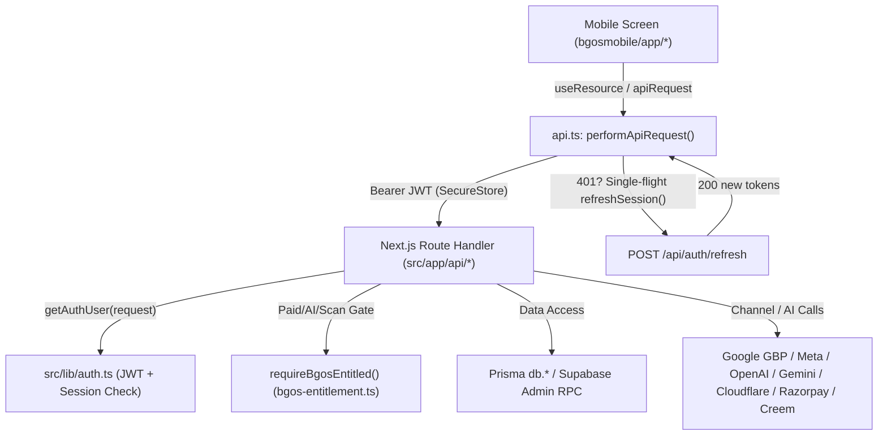

# BGOS Mobile — System Architecture & Technical Blueprint

**Audit Date:** 2026-11-27  
**Scope:** `bgosmobile/` (Expo React Native + Expo Router) and shared backend (`src/app/api/**`, `src/lib/**`, `shared/**`, `prisma/migrations/**`, `supabase/migrations/**`)  
**Principle:** All findings below are traced directly to observed source code, build output, and test runs.

---

## 1. High-Level Stack & Workspace Topology

| Layer | Technology / Versions (`bgosmobile/package.json`) | Primary Locations |
| --- | --- | --- |
| Mobile Runtime | Expo SDK `^58.0.0`, React `19.3.0`, React Native `0.88.1` | `bgosmobile/package.json:18-36` |
| Navigation & Routing | `expo-router ~58.0.30` (39 screen/layout `.tsx` files totaling 45,362 LOC) | `bgosmobile/app/_layout.tsx`, `bgosmobile/app/(tabs)/_layout.tsx` |
| State & Data Fetching | Zustand `^4.5.2` (`auth-store.ts`, `media-upload-store.ts`), custom `useResource` hook (`resource-cache.ts`) | `bgosmobile/src/stores/*`, `bgosmobile/src/hooks/use-resource.ts` |
| Networking & Auth | Custom `apiRequest` with refresh-token single-flight mutex & transient gateway retry | `bgosmobile/src/lib/api.ts:33-95`, `bgosmobile/src/lib/auth.ts` |
| Fonts & UI Icons | `@expo/vector-icons ^15.0.2` (`MaterialIcons` + 2 files using `MaterialCommunityIcons`) + 4 custom BGOS `.ttf` fonts | `bgosmobile/app/_layout.tsx:38-44`, `posts-list.tsx:15`, `channel-selector.tsx:3` |
| Native Auth Providers | Google PKCE OAuth (`expo-web-browser`), Apple Sign-In (`expo-apple-authentication`), Firebase Phone (`@react-native-firebase/auth`) | `bgosmobile/src/lib/google-auth.ts`, `apple-auth.ts`, `app/login.tsx` |
| Backend Runtime | Next.js App Router API routes (`src/app/api/**`), Prisma ORM (`db`), Supabase PostgREST RPC/Admin client (`supabase-rpc.ts`) | `src/app/api/**`, `src/lib/**` |
| Multi-Product Sharing | Cross-compiled pure TypeScript helpers shared with web (`shared/marketing-design.ts`, `shared/marketing-targets.ts`, `shared/image-review.ts`, `shared/poster-templates.ts`, `shared/bgos-contracts.ts`) | `shared/*` |

---

## 2. End-to-End Request & Auth Architecture

### Key Architectural Observations

1. **Dual Database Access Path Without Unified Policy Enforcement**
   - Most routes use Prisma (`db.*` in `src/lib/db.ts`), whereas hot dashboard/lead routes use `shouldUseSupabaseDB()` and `src/lib/supabase-rpc.ts:1-120` via `getAdminClient()` (`service_role`).
   - `supabase-rpc.ts` uses `SECURITY DEFINER` RPCs (e.g., `get_bgos_dashboard_summary` in `supabase/migrations/20261127000100_bgos_performance_rpcs_and_indexes.sql`), bypassing Postgres RLS cleanly only when parameters enforce `tenant_id` / `workspace_id`. Conversely, legacy setup policies in `src/app/api/setup-supabase-tables/route.ts:225-230` open RLS with `USING (true)` for `ALL` roles.

2. **Root & Tab Layout Tree (`bgosmobile/app/_layout.tsx` & `(tabs)/_layout.tsx`)**
   - `RootLayout` mounts splash animation (`AnimatedSplash`), font loading, universal/app link listeners (`https://bgos.site/open?...`, `bgos://open?...`), push token sync, notification handler, and a **15-second global `/api/notifications` interval poller** (`bgosmobile/app/_layout.tsx:300`).
   - `TabLayout` wraps the 5 visible tabs (`Home`, `Reviews`, `Posts`, `Media`, `Tools`) inside `<ProtectedRoute><View key={tenantId}>` (`bgosmobile/app/(tabs)/_layout.tsx:41-42`).
   - **Critical Architectural Defect (`(tabs)/_layout.tsx:31, 42`)**:
     - `usePendingReplies(60000)` is invoked at line 31 and **its return value is never rendered** on the `Reviews` tab badge, wasting a 60-second `/api/reviews` poll.
     - `<View key={tenantId}>` unmounts and remounts the entire tab navigator when `tenantId` resolves or switches.

3. **Workspace & Product Isolation Model**
   - Multi-tenant model combines `Tenant`, `User`, `Workspace`, `ProductWorkspace` (`product = 'bgos'`), `ProductMembership`, and `ProductSubscription` (`prisma/migrations/20261008120000_product_workspaces/migration.sql`).
   - Workspace switching calls `POST /api/bgos/workspaces/switch`, updates JWT claim / active workspace resolution via `resolveWorkspaceData` (`src/app/api/bgos/workspace/route.ts`), and invalidates client caches.
   - **Defect (`src/app/api/bgos/workspace/route.ts:110`)**: `resolveWorkspaceData` returns a `NextResponse` JSON error object when `!tenant` even though callers expect `Promise<BgosWorkspace | null>`, risking leaked HTTP response objects in internal server calls.

4. **Screen & Code Distribution (Measured by `wc -l`)**
   - Total lines in `bgosmobile/app/**/*.tsx`: **45,362 lines across 39 files** (79,268 lines combined with `src/components/gbp` & `src/components/design`).
   - Monolithic screen concentration:
     - `app/(tabs)/marketing.tsx`: **7,429 lines** (embeds AI Studio, Poster Editor, Autopilot, Campaigns, Social Calendar, Posts Board, Accounts Picker).
     - `app/agents.tsx`: **4,054 lines** (4 tabs, FAQ manager, document/URL crawler, live test chat).
     - `app/(tabs)/reviews.tsx`: **2,873 lines**.
     - `app/manage-profile.tsx`: **2,685 lines**.
     - `app/setup.tsx`: **2,153 lines**.
     - `app/(tabs)/index.tsx`: **2,086 lines**.

5. **Background Execution & Publishing Pipeline**
   - **Media Uploads (`bgosmobile/src/stores/media-upload-store.ts`)**: Handles concurrent multi-file cloud upload (up to S3/Supabase storage via `/api/...` upload helpers), optional web video poster extraction, and metadata persistence to `/api/social/photos`, surfacing progress via `GlobalUploadBanner`.
   - **Scheduled & Autopilot Publishing (`src/lib/social/due-publisher.ts`, `src/lib/social/publisher.ts`)**: Claims due `SocialPost` rows, reconciles stale `'publishing'` jobs after 15 minutes (`due-publisher.ts:42-78`), refreshes expired tokens (`token-refresh.ts`), and isolates per-platform failures cleanly (`published` / `partial` / `failed`).
   - **AI Image Generation (`src/app/api/social/designs/image/route.ts` + `src/lib/designs/jobs.ts`)**: Uses Next.js `after()` to trigger `runDesignJob()`, atomically claiming queued `DesignGenerationJob` rows (`updateMany` where `status='queued'`), enforcing entitlement & AI quota, resizing via `sharp`, writing JPEG EXIF geo-tags (`src/lib/designs/assets.ts:43-70`), and uploading to R2/Supabase storage.

---

## 3. Navigation & Module Map (39 Files in `bgosmobile/app/`)

- **Primary 5-Tab Shell (`(tabs)/_layout.tsx`)**:
  - `index.tsx` (Home)
  - `reviews.tsx` (Reviews)
  - `marketing.tsx` (Posts / Marketing)
  - `photos.tsx` (Media + inline AI Studio mode)
  - `tools.tsx` (Operations Hub)
- **Authentication & Onboarding Stack**: `index.tsx`, `login.tsx`, `recover.tsx`, `auth-callback.tsx`, `gbp-callback.tsx`, `open.tsx`, `setup.tsx`, `select-profile.tsx`.
- **SEO & Growth Stack**: `growth.tsx` (legacy Growth Workstation), `seo-growth.tsx` (AI Search & SEO: Audit / Keywords / Grid / Gap), `growth-report.tsx` (4-Tier Monthly Growth & Performance Report), `keyword-planner.tsx` (redirect stub to `/seo-growth?tab=keywords`).
- **CRM & AI Desk Stack**: `inbox.tsx`, `leads.tsx`, `appointments.tsx`, `submissions.tsx`, `agents.tsx`.
- **Business Presence & Settings Stack**: `manage-profile.tsx`, `booking-page.tsx`, `services-management.tsx`, `products-management.tsx`, `qr-standee.tsx`, `logo-management.tsx`, `reply-settings.tsx`, `campaign-planner.tsx`, `automations.tsx`, `integrations.tsx`, `team-management.tsx`, `preferences.tsx`, `my-plan.tsx`, `settings.tsx`, `help.tsx`.
